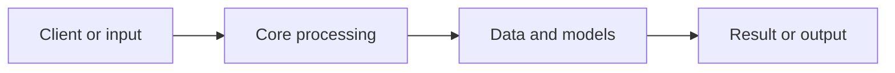

# Architecture and design choices

## Main components

- **1.** FastAPI submit
- **2.** PostgreSQL state
- **3.** Redis Streams consumer group
- **4.** Workers retry + DLQ
- **5.** DB/Redis enqueue not atomic; add outbox

## Engineering evidence to add

Record reproducible commands and a meaningful baseline; use real licensed data and workload assumptions; compare performance before/after optimization; add full deployment and integration tests; publish failure cases and architectural trade-offs. Never claim benchmarks you have not run.
